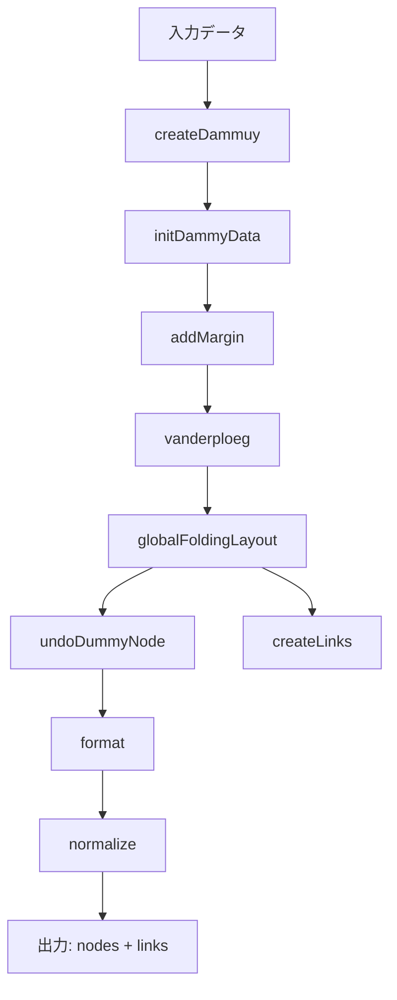

> 最終更新: 2026-09。実装（`src/layout/`）に同期済み。
>
> **このドキュメントは索引です。** アルゴリズムの詳細は各ファイル冒頭と関数のコメントを正とし、
> ここには「全体の流れ」と「どのファイルを見ればいいか」だけを置く。
> 設計の理由は [decisions/](decisions/) を参照。

# 可変サイズノードの根付き木レイアウト — 実装の索引

## 概要

可変サイズのノードを持つ根付き木を、指定された矩形領域（`width × height`）に収まるように
レイアウトする。兄弟の葉ノード群を**ダミーノード**にまとめ、その中の配置を
**グローバル高さ予算 `H_t` に基づく支配的ノード判定 + 容量ベースの配置戦略（既定LPT、他にFFD/BFD）**
で決めることで面積効率を上げる。

列分配は当初SA（焼きなまし法）で解いていたが、現在の主手法は `H_t` 方式
（[decisions/2026-07-global-budget-design.md](decisions/2026-07-global-budget-design.md)）。
SA と、そのソルバーを LPT に差し替えた版は、論文の比較対象として `methods/growth.js` に残っている。

---

## 全体フロー



### ステップ詳細

パイプライン全体は [core/pipeline.js](../src/layout/core/pipeline.js) の `runLayout()` にあり、
**手法ごとに差し替わるのは 5 の `fold` だけ**。

| # | 関数 | 定義場所 | 役割 |
|---|------|---------|------|
| 1 | `createDammuy` | [core/dummy.js](../src/layout/core/dummy.js) | 兄弟の葉ノードを**ダミーノード**にまとめる |
| 2 | `initDammyData` | core/dummy.js | ダミーノード内を1列の2次元配列に初期化 |
| 3 | `addMargin` | core/dummy.js | 全ノードにマージン（`xMargin`, `yMargin`, `innerYMargin`）を付与 |
| 4 | `vanderploeg` | [core/tree.js](../src/layout/core/tree.js) | van der Ploeg のアルゴリズムで初期レイアウト |
| 5 | **fold**（手法固有） | [methods/binpacking.js](../src/layout/methods/binpacking.js) の `globalFoldingLayout`<br>[methods/growth.js](../src/layout/methods/growth.js) の `localFoldingLayout` | 目標アスペクト比に合わせて全ダミーの列数を決める |
| 6 | `undoDummyNode` | [core/render.js](../src/layout/core/render.js) | ダミーノードを展開し、内部の葉ノードに最終座標を設定 |
| 7 | `createLinks` / `createDummyLinks` | core/render.js | ノード間のパス（エッジ）を生成 |
| 8 | `format` | core/render.js | マージンを差し引いた表示サイズを計算 |
| 9 | normalize | core/pipeline.js | 全体を `width × height` にスケーリング |

---

## グローバル高さ予算 `H_t` の考え方

現行の主手法（binpacking）の中核。導出と具体例は
[decisions/2026-07-global-budget-design.md](decisions/2026-07-global-budget-design.md) にある。

### 鍵になる不変量: `y_top(d)` は列数に依存しない

van der Ploeg のレイアウトでは `child.y = parent.y + parent.height/2 + child.height/2` により、ダミーノード `d` の上端 `y_top(d)` は祖先（分岐ノード、高さ固定）の積み上げだけで決まり、**ダミー自身の列数や中身に一切依存しない**。この不変量により、全ダミーの高さ予算を1つのスカラー `H_t` から独立に導出できる。

### `B_d`: 各ダミーの高さ予算

```
B_d = H_t − y_top(d)
```

### `H_t` の二分探索

`H_t` を大きくする → `B_d` が増える → 列数が減る → 幅が狭まる → アスペクト比が減る、という単調性を利用し、目標アスペクト比 `at` に対して `H_t` を二分探索する（`globalFoldingLayout`）。

- 上界 `H_max`: 全ダミーが1列のときの実測底辺（`computeGlobalBottom`）
- 下界 `H_min`: 全ダミーの `y_top` の最小値（`computeHMin`）。「これ以上 `H_t` を下げても、どのダミーも縮む余地がない」点
- 収束判定: `|a - at| / at < 0.05`、最大30回

### `H_t` が決まった後: ダミー内の列決定 (`computeColumnsForBudget`)

各ダミーは自分の `B_d` だけを見て独立に決まる（`applyGlobalBudget`）。

1. **支配的ノードの判定・幅拡張**: `h_i > B_d` のノードを支配的ノードとし、面積保存で高さ = `B_d` ちょうどに縮小（`新width = 元width × k`, `k = h_i / B_d`）。旧方式の「残りノードの理想列高さとの比較」という文脈依存の判定は不要になり、`B_d` との単純な閾値比較に一本化された。
2. **残りノードの列分配（配置戦略）**: 支配的ノードを除いた残りを、`packStrategy(items, B_d)` に渡して列に分配する。デフォルトはLPT（`src/packing/lpt.js`）: 列数の下限 `⌈Σh_i / B_d⌉` から開始し、`makespan ≤ B_d` を満たす最小列数になるまでLPT（高さ降順に、都度もっとも負荷の低い列(Min-Heapで管理)へ入れる `O(n log n)` の貪欲アルゴリズム）を再試行する。戦略の切り替え方法は後述。

```
例: toaruos/apps ダミー（bim.c が高さ348,560で突出）
  y_top = 3,000, H_t ≈ 143,750 → B_d = 140,750
  bim.c: 348,560 > B_d → 支配的ノード、k = 2.477 で幅拡張、高さ = B_d
  残り176ファイル → LPTで B_d に収まる最小列数に分配
```

### 配置戦略(packing strategy)の切り替え

「残りノードを`B_d`以下の列に詰める」処理は、**容量`B_d`のビンパッキング問題**として捉え直し、差し替え可能な戦略として`src/packing/`に切り出してある([decisions/2026-07-pluggable-packing.md](decisions/2026-07-pluggable-packing.md)参照)。

```js
// (items: {height, width, ...}[], capacity: number) => { columns: Item[][], columnHeights: number[] }
```

| 戦略名 | ファイル | 概要 |
|---|---|---|
| `"lpt"`(デフォルト) | `src/packing/lpt.js` | 列数を探索しながらLPTで割当(マルチプロセッサスケジューリングの流用) |
| `"ffd"` | `src/packing/firstFitDecreasing.js` | First-Fit Decreasing(古典的ビンパッキング) |
| `"bfd"` | `src/packing/bestFitDecreasing.js` | Best-Fit Decreasing(古典的ビンパッキング) |

```js
import { layout } from "./uiLayout";
layout(data, width, height, { packing: "ffd" }); // 文字列名 or 自作関数を直接渡せる
```

新しい戦略を追加するには `src/packing/` に上記シグネチャの関数を追加し、`src/packing/index.js` の `packingStrategies` に登録する(登録せず関数を直接`options.packing`に渡して試すことも可能)。

---

## ファイル構成

| ファイル | 役割 |
|----------|------|
| [layout/core/pipeline.js](../src/layout/core/pipeline.js) | 共通パイプライン。ダミー化→マージン→van der Ploeg→**fold**→展開→正規化。`fold` だけが手法固有 |
| [layout/core/tree.js](../src/layout/core/tree.js) | van der Ploeg 本体と輪郭（`vanderploeg`, `separate`, `rightSkyline`, `leftSkyline`, `calcAspectRatio`）。4手法で同一。輪郭は y の区間ごとの端の極値を持つスカイライン（[decisions/2026-09-contour-skyline.md](decisions/2026-09-contour-skyline.md)） |
| [layout/core/dummy.js](../src/layout/core/dummy.js) | ダミーノードの生成・サイズ計算・マージン付与 |
| [layout/core/render.js](../src/layout/core/render.js) | ダミー展開・エッジ生成・表示サイズ確定（`undoDummyNode`, `createLinks`, `format`） |
| [layout/methods/binpacking.js](../src/layout/methods/binpacking.js) | **現行の主手法**。`H_t` の二分探索（本ドキュメントの Step 5 以降の対象） |
| [layout/methods/growth.js](../src/layout/methods/growth.js) | 列成長型。SA手法とLPT手法をソルバー差し替えで表現 |
| [layout/solvers/](../src/layout/solvers/) | 列数k固定で makespan を最小化するソルバー（`saColumn.js`, `lptColumn.js`）。列成長型が使う |
| [packing/](../src/packing/) | 容量 `B_d` に収まる最小列数を求める配置戦略(`lpt.js`, `firstFitDecreasing.js`, `bestFitDecreasing.js`, `index.js`)。binpacking手法が使う |
| [uiLayout.js](../src/uiLayout.js) | UI のエントリ。`METHOD` の1行で手法を切り替える（binpacking / growth / existing）。マージンは100/100 |
| [App.jsx](../src/App.jsx) | UI。**入力データは `const data = [...]` に直書き**（1002ノードのランダム生成データ） |
| [Tree.jsx](../src/Tree.jsx) | SVG描画コンポーネント。`layout(..., { packing: "bfd" })` を呼ぶ |
| [test/golden.mjs](../test/golden.mjs) | 全手法の出力をハッシュで固定する回帰テスト（`npm run test:golden`） |

論文実験用のエントリ（`experiments/lib/existingPaper.js` / `saColumnPaper.js` / `growthLPTPaper.js` / `globalBudgetPaperMargin.js`）は、マージンを 300/200 に設定して `src/layout/` を呼ぶラッパー。ただし `existingPaper.js` だけは別系統の実装のまま（[decisions/2026-09-layout-core-extraction.md](decisions/2026-09-layout-core-extraction.md) の「残っている作業」参照）。

## 手法の対応表

| 手法 | 外側ループ | 内側で解く問題 | ソルバー | 実装 |
|---|---|---|---|---|
| 既存（Misue） | 折りたたみ | — | — | `src/layout/methods/existing.js` |
| SA | 列成長（列を1つずつ増やす） | 列数k固定 → 最大列高さ最小化 | `solvers/saColumn.js` | `src/layout/methods/growth.js` |
| LPT | 列成長 | 同上 | `solvers/lptColumn.js` | 同上（ソルバー違い） |
| binpacking | `H_t` の二分探索 | 容量 `B_d` → 最小列数 | `src/packing/{lpt,ffd,bfd}.js` | `src/layout/methods/binpacking.js` |

**`solvers/` と `packing/` は解いている問題が違う**（前者は列数固定の makespan 最小化、
後者はその双対の箱詰め）ので、混ぜないこと。

## 変更したら確認すること

```bash
npm run test:golden   # 全手法の出力ハッシュ（192ケース）。挙動を変えたかどうかの判定はこれ
npm run build         # UI がビルドできるか
```

意図した変更で出力が変わった場合は `npm run test:golden:update` で記録を更新する。

関連ドキュメント: [known-issues.md](known-issues.md) / [decisions/](decisions/) / [references/](references/) / [paper/](paper/)
